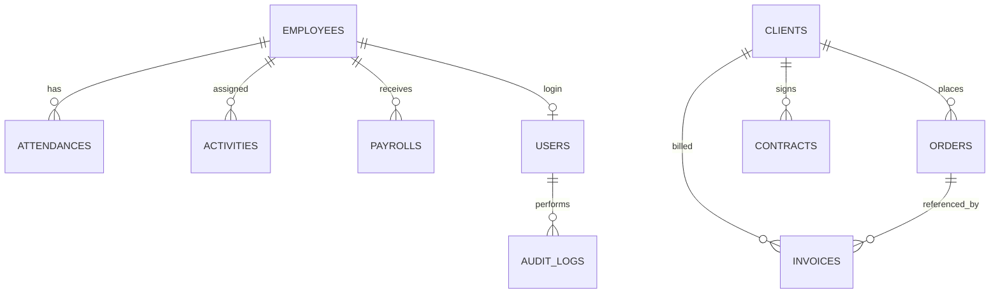

# Arsitektur SIM-LJI

## Pola aplikasi

Modular monolith Laravel: satu aplikasi, satu database MySQL, modul dipisah berdasarkan domain bisnis. UI memakai Blade dan CSS responsif; validasi, kalkulasi, dan otorisasi dilakukan di server.

## Cakupan 12 modul

| No. | Modul | Tabel utama | Keterangan awal |
|---:|---|---|---|
| 1 | Data Karyawan | `employees` | Identitas, jabatan, departemen, status, gaji pokok |
| 2 | Data Absensi | `attendances` | Per karyawan dan tanggal; satu catatan per hari |
| 3 | Aktivitas Karyawan | `activities` | Aktivitas, progres, status |
| 4 | Data Gaji | `payrolls` | Periode, komponen gaji, gaji bersih hasil kalkulasi |
| 5 | Data Klien | `clients` | Identitas dan kontak klien |
| 6 | Pemesanan/Penjualan | `orders` | Pesanan terkait klien; total dihitung server |
| 7 | Arsip Kontrak | `contracts` | Metadata kontrak dan lampiran privat |
| 8 | Inventaris Perusahaan | `assets` | Identitas, nilai, kondisi, penanggung jawab |
| 9 | Legalitas Perusahaan | `legal_documents` | Metadata masa berlaku dan lampiran privat |
| 10 | Invoice | `invoices` | Klien, pesanan terkait, tanggal, nilai, status, lampiran privat |
| 11 | Pengeluaran Perusahaan | `expenses` | Kategori, nilai, metode, status |
| 12 | Laporan Laba/Rugi | — | Ringkasan berdasarkan pesanan selesai, pengeluaran disetujui/dibayar, dan gaji disetujui/dibayar |

## Relasi utama

## Role dan batas akses

- `super_admin`: seluruh modul dan manajemen akun pengguna.
- `director`: seluruh modul bisnis dan laporan, kecuali manajemen akun pengguna.
- `hr`: karyawan, absensi, aktivitas, penggajian.
- `finance`: penggajian, klien, pesanan, invoice, pengeluaran, laporan.
- `operations`: aktivitas, klien, pesanan, kontrak, inventaris, pengeluaran.
- `staff`: hanya data karyawan miliknya, absensi, aktivitas, dan penggajian miliknya. Akun staff wajib ditautkan ke satu data karyawan.

Role diperiksa pada route/controller di server. Sidebar hanya membantu navigasi, bukan lapisan keamanan.

## File privat

Lampiran kontrak, legalitas, dan invoice disimpan di disk `local` pada `storage/app/private`, tidak berada di `public/`. Download melewati route yang memeriksa role terlebih dahulu. Format yang diterima PDF/JPG/PNG, maksimal 10 MB.

## Batasan laporan keuangan versi awal

Laporan merupakan ringkasan manajerial, bukan laporan keuangan formal. Pendapatan awal dihitung dari pesanan berstatus `Selesai`. Beban dihitung dari pengeluaran berstatus `Disetujui` atau `Dibayar` dan payroll berstatus `Disetujui` atau `Dibayar`. Sebelum dipakai sebagai laporan resmi, perlu disepakati kebijakan pengakuan pendapatan, pajak, akun, jurnal debit-kredit, piutang, pembayaran parsial, penyusutan, dan tutup periode oleh penanggung jawab keuangan.

## Pengembangan berikutnya

1. Workflow persetujuan dan pemisahan tugas (maker-checker).
2. Pembayaran invoice parsial dan rekonsiliasi.
3. Jurnal umum double-entry dan bagan akun untuk laporan resmi.
4. Ekspor PDF/XLSX, notifikasi, dan histori perubahan yang lebih rinci.
5. MFA, reset password, monitoring, backup otomatis, dan uji pemulihan.
6. QA integrasi dan browser pada environment yang sudah memiliki Composer, dependency Laravel, dan MySQL.
